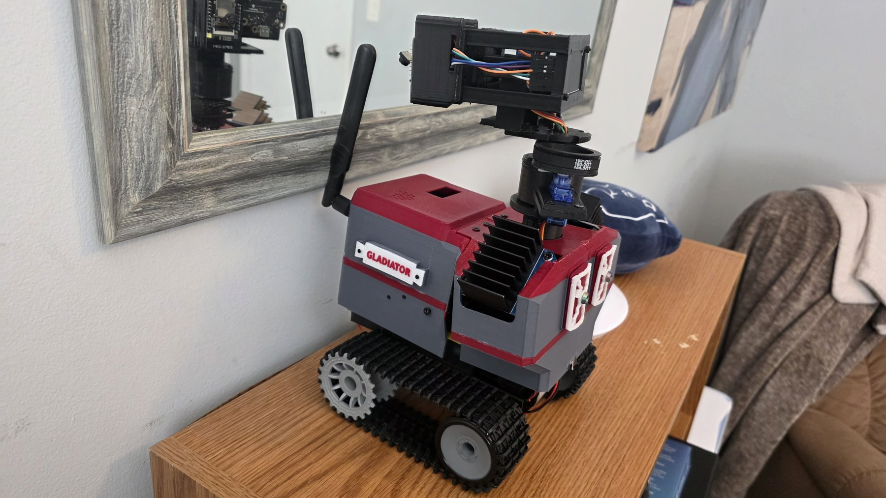
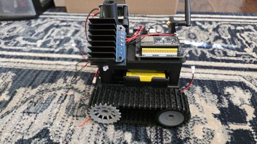
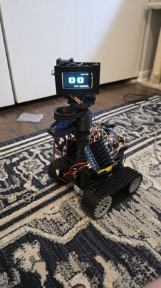
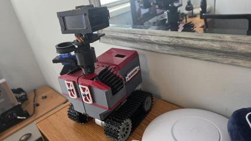

# Gladiator

<!-- WRITE: Introduce Gladiator in your own words. -->

[Project](docs/PROJECT.md) · [Build log](docs/BUILD_LOG.md) · [Hardware & CAD](hardware/README.md) · [Firmware](firmware/README.md) · [Photos](photos/README.md)

## The project

<!-- WRITE: What you built and why. -->

## See the build

| Chassis | Robot v1 | Robot v2 |
| --- | --- | --- |
|  |  |  |

## Features

<!-- WRITE: The features you want to highlight. -->

## Current status

<!-- WRITE: What works today and what you want to do next. -->

## Hardware and software

<!-- WRITE: Your overview. The technical indexes are already linked above. -->

## Credits and licensing

<!-- WRITE: Credits, attribution, and your licensing choice. No license has been assigned for you. -->
